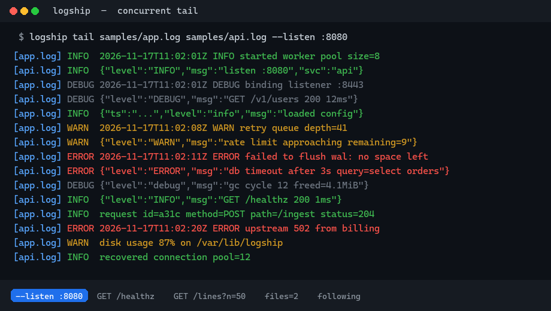

# logship

Go concurrent tail. Level color. /healthz.



## interface

Terminal: one line per record, file tag in cyan, then a 5-char level and the raw text.

| tag | color | how it is detected |
|---|---|---|
| `[app.log]` | cyan | basename of the path |
| `ERROR` | red | JSON `"level"` / `"lvl"` / `"severity"`, or tokens `ERROR` `ERR` `FATAL` |
| `WARN` | yellow | `WARN` `WARNING` |
| `INFO` | green | `INFO` `NOTICE` |
| `DEBUG` | dim | `DEBUG` `TRACE` |

HTTP (optional `--listen :8080`):

| method | path | body |
|---|---|---|
| GET | `/healthz` | `{ "files": [{ "path", "bytes_read", "last_line_time" }], "bytes_read", "last_line_time" }` |
| GET | `/lines?n=50` | `{ "n", "count", "lines": [{ "file", "level", "text", "time" }] }` |

`--json-out` prints JSON lines instead of ANSI. `--level error,warn` keeps only those severities (default: all).

## session

```
$ logship tail samples/app.log samples/api.log --listen :8080
logship  --listen :8080  GET /healthz  GET /lines?n=50
[app.log] INFO  2026-11-17T11:02:01Z INFO started worker pool size=8
[api.log] INFO  {"level":"INFO","msg":"listen :8080","svc":"api"}
[app.log] WARN  2026-11-17T11:02:08Z WARN retry queue depth=41
[api.log] ERROR {"level":"ERROR","msg":"db timeout after 3s query=select orders"}
```

Each file is followed from byte 0, then like `tail -F` (truncate + rotate). One goroutine per file.

## build

```
go test ./... && go build -o logship . && ./logship tail samples/app.log samples/api.log
```

With status HTTP:

```
./logship tail samples/app.log samples/api.log --listen :8080
curl -s localhost:8080/healthz
curl -s 'localhost:8080/lines?n=50'
```
